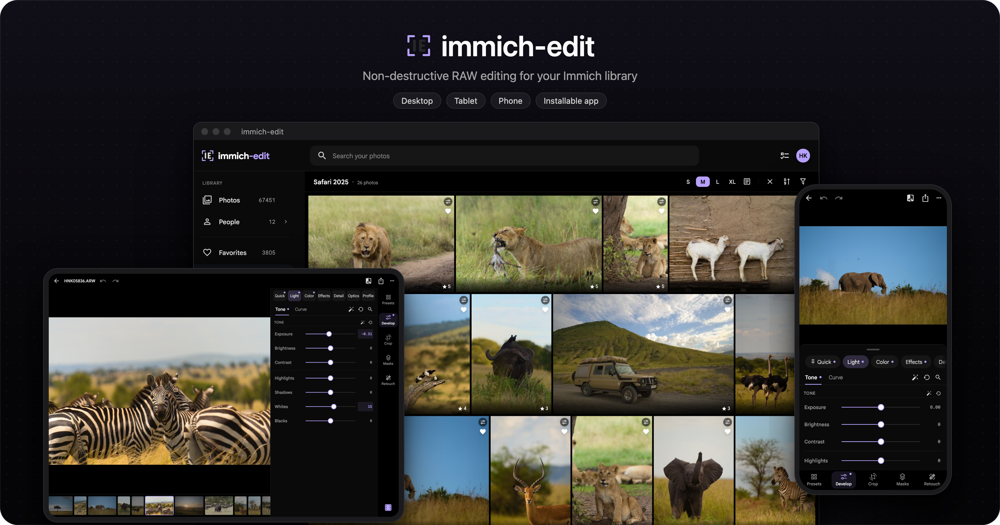

#  immich-edit

Self-hosted, non-destructive RAW photo editor for your [Immich](https://immich.app/) library. Browse
and cull through Immich, edit with live GPU previews on desktop, tablet, or phone, and export back
to Immich without touching originals.

> [!WARNING]
> immich-edit is under active `0.x` development. Back up `DATA_DIR` and read the
> [upgrade notes](https://haavardnk.github.io/immich-edit/hosting/backup-and-upgrade/) before
> upgrading.

## Documentation

Full documentation lives at **[haavardnk.github.io/immich-edit](https://haavardnk.github.io/immich-edit/)**:

- [Install](https://haavardnk.github.io/immich-edit/start/install/) — Docker Compose setup and first sign-in
- [Editing guide](https://haavardnk.github.io/immich-edit/editing/workspace/) — workspace, culling, map, Develop, masks, presets, and export
- [Self-hosting](https://haavardnk.github.io/immich-edit/hosting/deployment/) — reverse proxy, GPU passthrough, OAuth, configuration, and backups
- [Troubleshooting](https://haavardnk.github.io/immich-edit/hosting/troubleshooting/) — fixes for setup, GPU, and connection issues
- [Features & formats](https://haavardnk.github.io/immich-edit/reference/features/) — supported capabilities, RAW cameras, and shortcuts

## Community & License

- Questions and setup help: [GitHub Discussions](https://github.com/haavardnk/immich-edit/discussions)
- Bugs and feature requests: [GitHub Issues](https://github.com/haavardnk/immich-edit/issues)
- Security vulnerabilities: [Security Advisories](https://github.com/haavardnk/immich-edit/security/advisories/new)
- Contributing: [CONTRIBUTING.md](CONTRIBUTING.md)

Community support is best effort with no response-time guarantee. Licensed under
[AGPL-3.0-only](LICENSE); third-party credits in [contributing/attributions.md](contributing/attributions.md).
