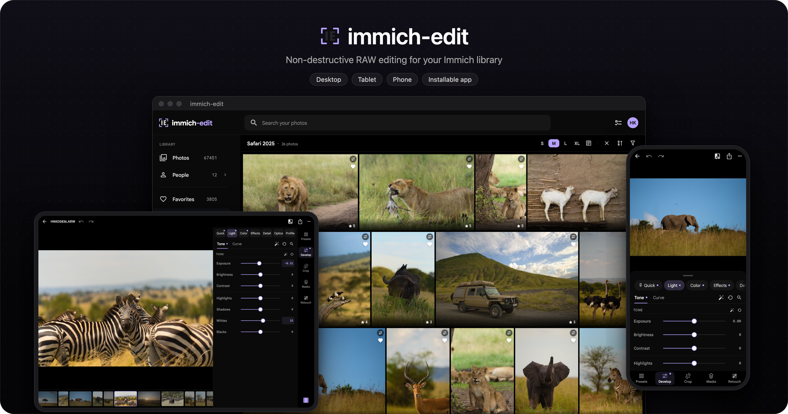

# immich-edit

A self-hosted, non-destructive RAW editor for an existing [Immich](https://immich.app/) library.
It browses and culls your photos through Immich, keeps edits in its own database, and exports the
results back to Immich. Originals are never changed.

<!-- SCREENSHOT: Same image as README.md; captured from the maintainer's library on the dev server (album "Safari 2025", each photo developed with Auto and lens corrections on, account shown as Hanne Kristiansen at photos.example.net): desktop album grid 1440x900 sorted by rating, tablet editor 1180x820, phone editor 412x839, composed into a 1600x840 banner at scale 2. -->

## Where to start

- [Getting started](getting-started.md) installs immich-edit and connects it to Immich.
- [Use the editor](use.md) walks through culling, editing and exporting.
- [Run the server](operate.md) covers HTTPS, GPUs, OAuth, configuration and backups.
- [Troubleshooting](troubleshooting.md) is organized by symptom and error message.
- [Contribute](contribute.md) has the development setup and architecture.

## Get help

- Ask usage and setup questions in
  [GitHub Discussions](https://github.com/haavardnk/immich-edit/discussions).
- Report reproducible bugs and request features in
  [GitHub Issues](https://github.com/haavardnk/immich-edit/issues).
- Report vulnerabilities privately through
  [GitHub Security Advisories](https://github.com/haavardnk/immich-edit/security/advisories/new).

Community support is best effort, with no response-time guarantee.
