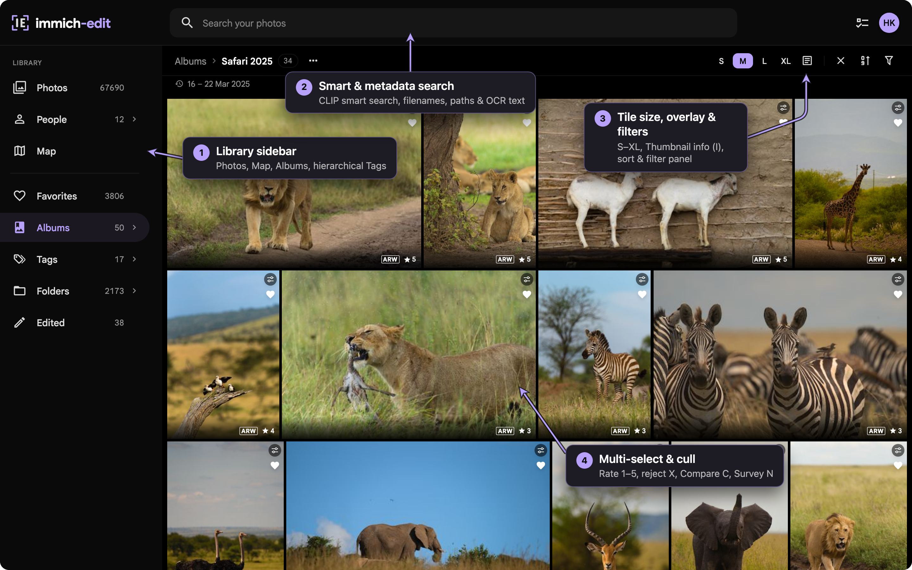
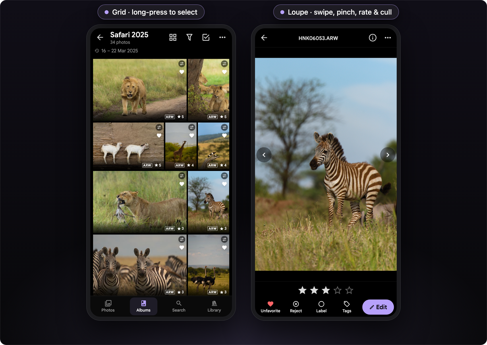
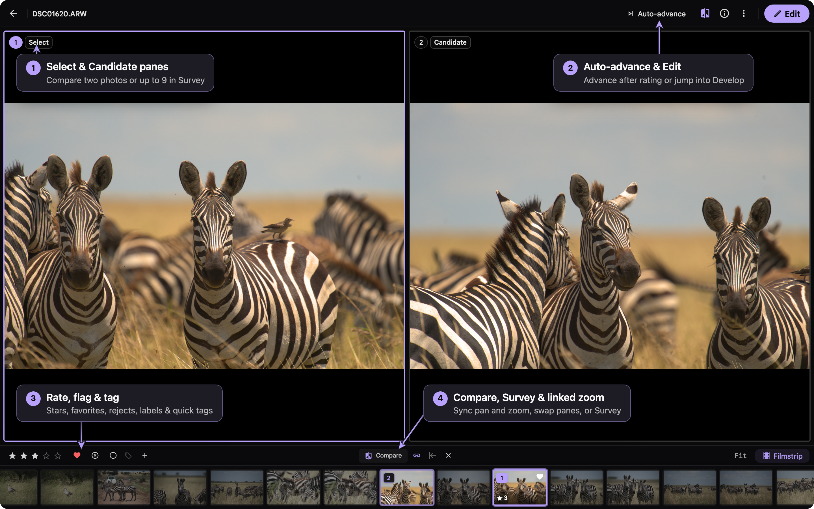

immich-edit browses your Immich library directly and writes ratings, favorites, tags, color labels,
and reject marks back to Immich after a one-time confirmation in each browser.

## Navigate and filter

Browse **Photos**, **Albums**, **People**, **Tags**, **Folders**, **Map**, **Favorites**,
**Edited**, **Archive**, and **Hidden**.

- **Search**: smart CLIP search (when enabled in Immich) plus filename, description, folder/path,
  and OCR text search.
- **Filters**: combine rating, favorite, color label, reject state, albums, people, tags, date
  taken/added, camera/lens, place, file size, and visibility. Active filters stay in the URL for
  bookmarks and browser navigation.
- **Saved views**: select **Save view** to store a filter, sort order, and thumbnail size under a
  name in your account.
- **Timeline tools**: day headers select an entire day; the date scrubber jumps to any month. Hold
  `W` over any grid tile to peek at a larger preview.

<!-- SCREENSHOT: capture.cjs browse-desktop + compose.cjs browse-desktop -->

## Albums and tags

- **Albums**: create, rename, describe, delete, or leave Immich albums from **Album actions** (`⋯`),
  right-click, or touch long-press. Set an album's cover from the loupe `⋯` menu (**Set as album
  cover**). Deleting or leaving an album never deletes photos.
- **Tags**: browse Immich's tag hierarchy as a colored tree in the sidebar and on **Tags**. Create
  tags or sub-tags, rename (Immich 3.3+), recolor, or delete tags from **Tag actions** (`⋯`).
  Internal `immich-edit/` tags used for color labels and rejects stay hidden.

## Rate, reject, and label

Click or tap a photo to open the loupe, then cull with keyboard or touch controls:

- `1`–`5` sets star rating (`0` clears); `P` toggles favorite; `X` marks rejected.
- `6`–`9` sets Red, Yellow, Green, or Blue color labels (Purple is in the label menu).
- Turn on **Auto-advance** in the loupe to move to the next photo after each rating.
- Press `Alt+1`–`8` in the loupe to apply recent tags quickly.
- Press `I` for **Photo info** (EXIF, description editing, mini map, and tags).

<!-- SCREENSHOT: capture.cjs browse-phone + loupe-phone + compose.cjs browse-touch -->

## Compare, survey, and virtual copies

Select multiple photos (box-drag between tiles on desktop, or press-and-hold on touch) to act in
bulk:

- **Compare**: inspect two photos side by side with synchronized or independent zoom and pan.
- **Survey**: view up to 9 photos together (4 on portrait tablets) to pick the strongest frame.
- **Face-aware zoom**: steps through Immich-detected faces, or the sharpest region when none exist.
- **Virtual copies**: create independent edit versions of the same RAW without duplicating the
  original in Immich. Copies share Immich metadata (rating, favorite, tags).
- **Trash**: move owned photos to the Immich trash (with **Undo**). Permanent deletion stays in
  Immich. For a photo from an external library, Immich needs write access to the library folder
  to delete the file; without it, the next library scan imports the photo again.

<!-- SCREENSHOT: capture.cjs cull-desktop + compose.cjs cull-desktop -->

