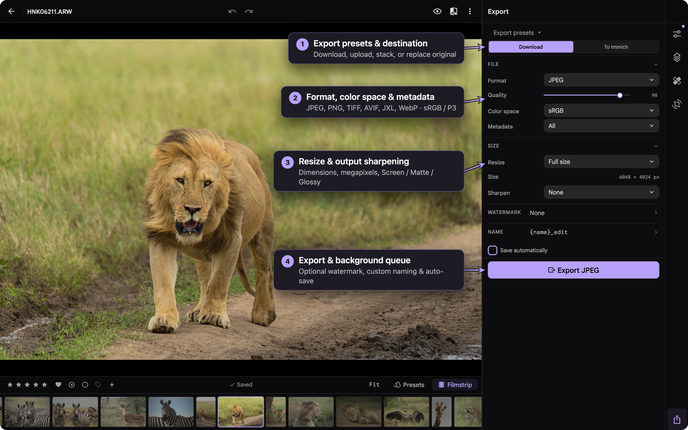

Open **Export** from the tool rail (or **Share** on phone and tablet) to render full-resolution
files on the server, either for one photo or a grid selection.

## Formats and color

- **Formats**: JPEG (8-bit), PNG (8/16-bit), TIFF (8/16-bit), WebP (8-bit lossy or lossless), HEIC
  (8-bit), AVIF (8-bit), and JPEG XL (8/16-bit).
- **Color space**: **sRGB** or **Display P3** with embedded ICC profile and automatic gamut
  mapping.
- **Resize**: constrain by width × height, megapixels, or percentage, with optional upscaling.
- **Output sharpening**: post-resize sharpening tuned for **Screen**, **Matte**, or **Glossy**
  paper at low, standard, or high strength.
- **Metadata**: keep safe EXIF (all, all except GPS location, or none). Capture time, time zone,
  location, and description come from Immich, so corrections made there carry into the exported
  file.
- **Watermark**: overlay an admin-imported PNG watermark with configurable size, opacity, inset,
  and 9-point placement.
- **Filenames**: format output names with `{name}`, `{date}`, `{seq}`, and `{preset}` tokens.

<!-- SCREENSHOT: capture.cjs export-desktop + compose.cjs export-desktop -->

## Destinations

### Upload to Immich

Uploads the rendered file back to Immich, copying the original's date, time zone, location,
description, and rating:

- Add to albums, apply tags, or copy the favorite state.
- **Stack with original**: group the export with the RAW (either can be the stack primary).
- **Replace original**: transfers albums, shared links, favorite state, and stack to the upload,
  then moves the original to the Immich trash. Requires Immich trash to be enabled and owner
  permissions. For an original from an external library, Immich needs write access to the library
  folder to delete the file; without it, the next library scan imports the original again.
- **Upload conflict policy**: when re-exporting a photo, choose **Keep both**, **Replace**, or
  **Skip**.

### Save, share, or copy

- **Download**: saves a single file or a ZIP archive for batch selections. Enable **Save exports
  automatically** in **Settings** > **Preferences** to download as soon as a render finishes.
- **Share**: sends a single exported photo to your device's native share sheet where supported.
- **Copy image**: copies the rendered photo to the clipboard as a PNG.

## Export presets and batch jobs

Save named **Export presets** from the export panel (manage them under **Settings** > **Account** >
**Export presets**). You can run multiple export presets at once — each destination runs as a
persistent background job with progress, retry for failed photos, and optional browser completion
notifications.
