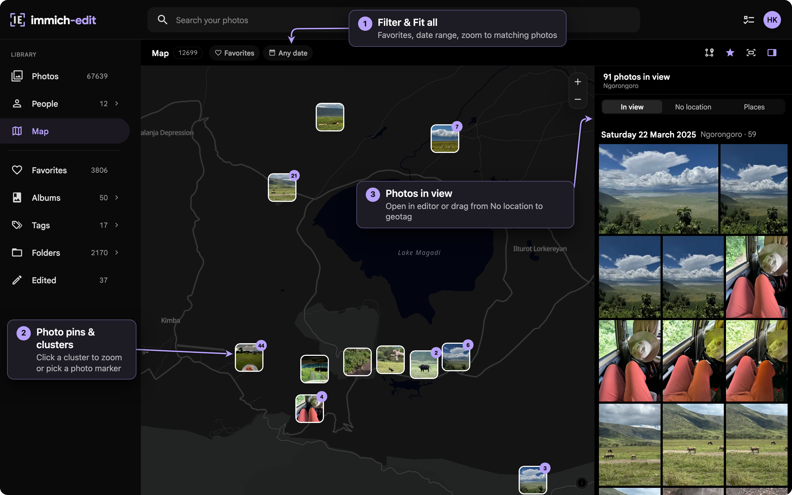
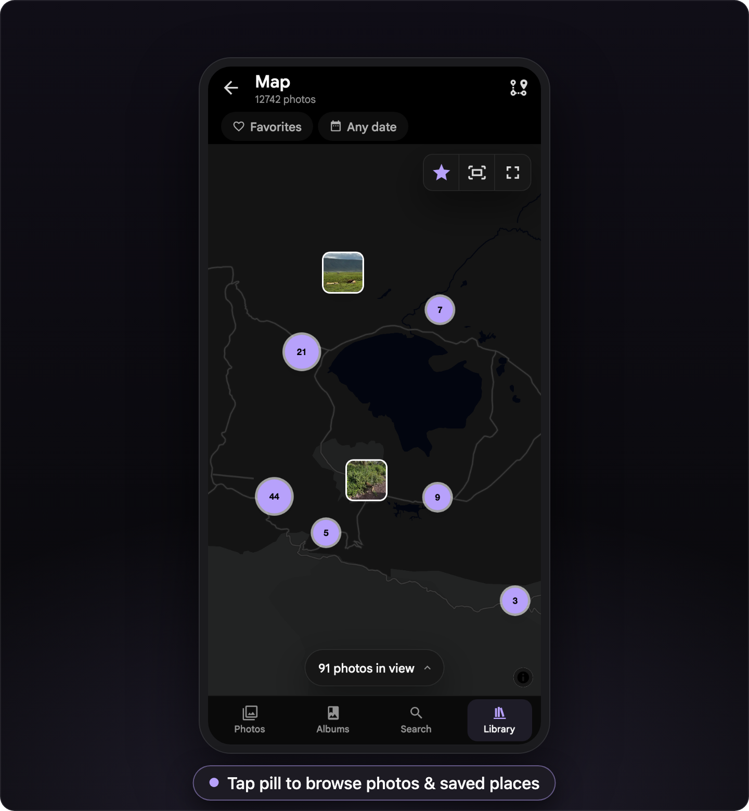

Open **Map** from the sidebar (under **Library** > **Collections** on phones) to explore your
geotagged library and assign missing locations.

## Browse the map

- Clusters expand into individual photo markers as you zoom in.
- Filter the map by **Favorites** and date range, or select **Fit all** to frame every matching
  marker.
- On desktop and landscape tablets, the side panel lists photos in the current map view; on phones
  and portrait tablets, drag the bottom sheet up to browse them.
- Open any photo in the loupe or editor and return directly to your map position.

<!-- SCREENSHOT: capture.cjs map-desktop + compose.cjs map-desktop -->

<!-- SCREENSHOT: capture.cjs map-phone + compose.cjs map-phone -->

## Set or move locations

Locations can be set or updated on photos you own (Immich does not support clearing GPS coordinates
in bulk, so a location can be moved but not removed):

- **Single photo**: open **Photo info** (`I`) to see the mini map, then choose **Set location** or
  **Edit location**. Search by place name or drag the pin, then select **Save**.
- **Multiple photos**: select photos in the grid and open **Location** in the bulk bar (or the
  **More** sheet on touch), then **Choose on map**.
- **Drag onto the map**: drag tiles from the map panel — including the **No location** tab — onto
  the map to geotag them, or drag an existing marker to refine its position (press and hold first
  on touch).
- **Copy and paste**: copy a photo's location from **Photo info**, the **Location** menu or with
  `Alt+Shift+C`, then paste it onto any selection with **Paste location** or `Alt+Shift+V`. The
  copied place lasts until you close the tab, and its coordinates also land on the system clipboard
  as text for other apps.

<!-- SCREENSHOT: capture.cjs location-desktop + compose.cjs location-desktop -->

## Tiles and privacy

Map tiles follow Immich's map style by default (or a custom MapLibre style set by an administrator),
loaded directly by your browser. Place searches use Photon proxied through immich-edit so the
geocoder never sees your browser IP, and reverse-geocoded place names come from Immich locally. See
[Administration](../hosting/administration.md#map).
