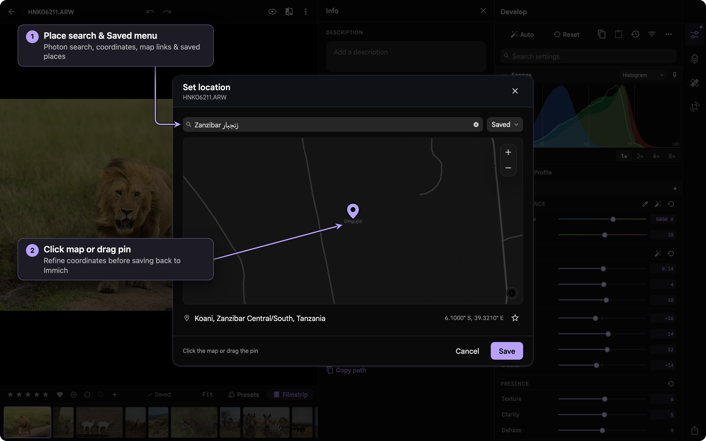
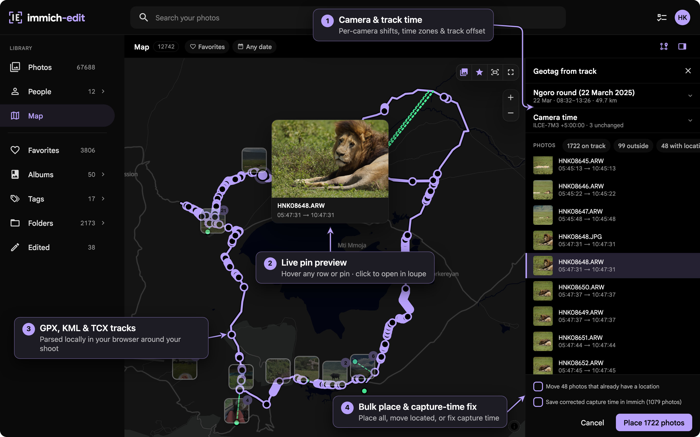

Open **Map** from the sidebar (under **Library** > **Collections** on phones) to browse geotagged
photos, manage saved places, and assign missing locations.

## Browse the map

- Clusters expand into individual photo markers as you zoom in.
- Filter by **Favorites** and date range, or select **Fit all** to frame every matching marker.
- On desktop and landscape tablets, the side panel lists photos in view, unplaced photos, and saved
  places; on phones and portrait tablets, tap the floating pill at the bottom to open them.
- Open any photo in the loupe or editor and return directly to your map position.

<!-- SCREENSHOT: capture.cjs map-desktop + compose.cjs map-desktop -->

<!-- SCREENSHOT: capture.cjs map-phone + compose.cjs map-phone -->

## Set or move locations

Locations can be set or updated on photos you own (Immich does not support clearing GPS coordinates
in bulk, so a location can be moved but not removed):

- **Single photo**: open **Photo info** (`I`) to see the mini map, then choose **Set location** or
  **Edit location**. Search by place name or drag the pin, then select **Save**.
- **Coordinates and map links**: paste coordinates (`60.3913, 5.3221` or `60°23'29"N 5°19'20"E`)
  or a Google Maps, Apple Maps, OpenStreetMap, or `geo:` link into search and choose **Go to**
  (parsed locally in your browser, even with place search disabled).
- **Multiple photos**: select photos in the grid and open **Metadata** > **Location** in the bulk
  bar (or **More** > **Metadata** on touch), then **Choose on map**.
- **Drag onto the map**: drag tiles from **In view** or **No location** onto the map, or drag an
  existing marker to refine it (press and hold first on touch).
- **Copy and paste**: copy a photo's location from **Photo info**, the **Location** menu, or
  `Alt+Shift+C`, then paste it onto any selection with **Paste location** or `Alt+Shift+V` (also
  copies coordinates to the system clipboard).

## Saved and recent places

- **Save a place**: in the location picker, select the star beside the place name, name it, and
  choose **Save place** — or select **New place** in the **Places** tab, or right-click (press and
  hold on touch) anywhere on the map and choose **Save place here**.
- **Reuse**: open **Saved** beside the search field, type part of a name, or pick a saved or recent
  place directly from **Metadata** > **Location** in the bulk bar.
- **On the map**: toggle saved place stars from the map header. Photos dropped near a star snap to
  it; selecting a star copies its location, moves or renames it, or places the current selection
  there.
- **Manage**: rename, move, or remove saved places and clear recent places from the **Places** tab
  on **Map**. Saved and recent places sync across your devices.

<!-- SCREENSHOT: capture.cjs location-desktop + compose.cjs location-desktop -->

## Match photos to a track

Geotag still photos from a GPX, KML, or TCX track recorded by a watch, phone app, or GPS logger:

1. Select photos and choose **Metadata** > **Location** > **Match to a track**, or select **Match
   track** in the map header to match every photo taken during the track.
2. Drop or choose one or more track files (parsed locally in your browser; only saved coordinates
   are sent to Immich).
3. Align the camera clock: select **Use** on the **Best fit** bar to apply the suggested shift, or
   expand **Camera clock** to adjust the **Time zone** and a per-camera **Shift by** (`-1:02:14`,
   with a **Camera** picker when multiple cameras are present). Unzoned photos default to the
   track's time zone.
4. If the track's own clock was off, expand the **Track** row and set the file's **Shift by**. The
   row also adds and removes track files and sets **Match within**.
5. Photos that already have a location show as green pins where they are, with a dashed line to
   the track when they sit more than 50 m from it. Hover any pin or list row on desktop (tap once
   on touch) to preview the photo on the map; click (tap again on touch) to open it in the loupe
   and step through the track with arrow keys.
6. Select **Place** to save. Tick **Move … photos that already have a location** to overwrite
   existing GPS coordinates, or **Change the capture time of … photos** to write the shift back
   to Immich; **Undo** restores both.

<!-- SCREENSHOT: capture.cjs track-desktop + compose.cjs track-desktop -->

## Tiles and privacy

Map tiles follow Immich's map style by default (or a custom MapLibre style set by an administrator),
loaded directly by your browser. Place searches use Photon proxied through immich-edit so the
geocoder never sees your browser IP, and reverse-geocoded place names come from Immich locally. See
[Administration](../hosting/administration.md#map).
