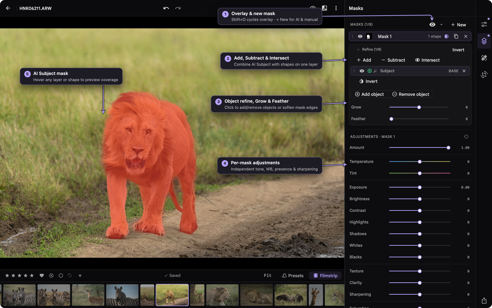
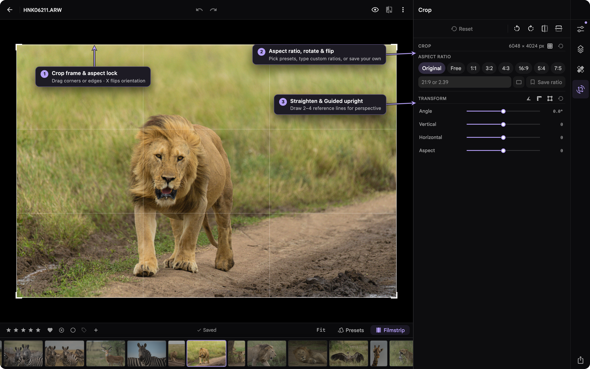

Local adjustments, spot removal, and framing live in the **Masks**, **Retouch**, and **Crop** tabs.

## Masks

Each photo supports up to 8 mask layers (up to 8 shapes per layer, 32 shapes total). Every mask
layer has its own exposure, tone, white balance, saturation, vibrance, texture, clarity, and
sharpening sliders.

<!-- SCREENSHOT: capture.cjs masks-desktop + compose.cjs masks-desktop -->

### Build a mask

Start a layer with an AI selection or a manual shape, then refine it with **Add**, **Subtract**,
or **Intersect**:

- **AI masks** (require admin-installed models): **Subject**, **Background**, **People**, **Sky**,
  **Depth**, **Scene**, **Click to select**, and **Box select**. In **Click to select**, click to
  include or `Shift`-click / right-click to exclude.
- **Manual shapes**: **Brush**, **Linear gradient**, **Radial gradient** (rotatable), **Polygon**,
  **Luminance range**, and **Color range**.
- **Range sampling**: toggle **Sample** on a luminance or color range mask and click or drag a box
  on the photo (`Shift` adds to the sample).

### Fast mask controls

- Hold `Alt` while painting with **Brush** to erase temporarily.
- Hold `Alt` + scroll to resize a brush, linear, radial, or polygon mask; `Alt+Shift` + scroll
  adjusts feather.
- Press `Shift+O` to cycle mask overlay modes (tint, color on B&W, white on black); hover any layer
  or shape row on desktop (or hold on touch) to preview its coverage.
- Drag layer or shape rows to reorder them.

## Retouch

Use **Retouch** for non-destructive **Heal** (blends texture and tone) and **Clone** (copies pixels
directly) strokes:

1. Paint over a spot or distraction; immich-edit picks a nearby source patch automatically (on
   touch, the first tap sets the source, then one finger paints).
2. Drag the source ring to refine the sample area, or adjust **Size**, **Feather**, and **Opacity**
   for the selected stroke.
3. Toggle **Visualize** to highlight sensor dust and faint spots in high contrast.

## Crop and transform

Open **Crop** (`Shift+R`) to frame, level, and correct perspective:

- **Crop**: pick an aspect ratio chip, type a custom ratio, or select **Save ratio** to keep it.
  Rotate 90° or flip from the action row above.
- **Straighten** (`A`): drag a line along a horizon or vertical edge to level the photo
  (`Shift`+drag inside the crop does the same). On touch, drag the live straighten dial.
- **Perspective & Guided upright**: adjust vertical/horizontal keystone and aspect, drag four
  **Corner handles**, or toggle **Guided upright** and draw 2–4 vertical (blue) and horizontal
  (amber) lines to solve perspective automatically.

<!-- SCREENSHOT: capture.cjs crop-desktop + compose.cjs crop-desktop -->

