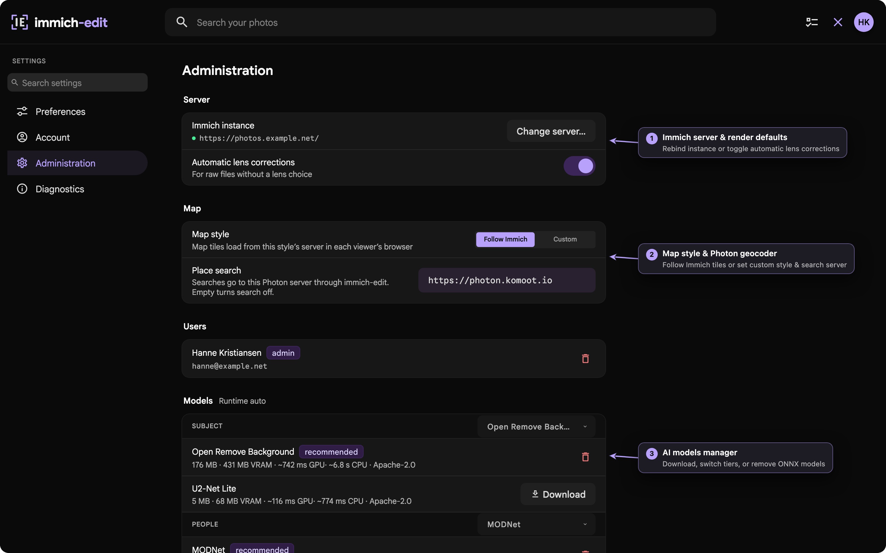

Open **Settings** from the avatar menu. Press `/` inside Settings to search any control by name.

- **Preferences**: per-account **Appearance** plus per-browser **Layout**, **Preview renderer**,
  **Save exports automatically**, and **Install app**.
- **Account**: active profile, **Signed-in devices** (revoke individual or all other sessions), and
  **Export presets**.
- **Administration** (Immich admins only): **Server**, **Map**, **Users**, and **Models**.
- **Diagnostics**: live server, GPU, browser renderer, codec, latency, cache, and redacted config
  status, with **Copy support bundle** for bug reports.

<!-- SCREENSHOT: capture.cjs admin-desktop + compose.cjs admin-desktop -->

## Users and security

Users sign in with Immich (OAuth, password, or API key). Local edits, history, presets, jobs, and
exports are isolated per user; ratings, favorites, tags, and rejects sync through Immich.

- Under **Administration** > **Users**, disable access (revokes sessions, keeps data) or purge a
  user's local data (requires confirming their email).
- Session cookies are `HttpOnly` and `SameSite=Strict`; stored Immich credentials are encrypted
  with `DATA_DIR/instance.key`.

## Editing defaults and shared assets

- **Automatic lens corrections** (**Administration** > **Server**): instance-wide default (on by
  default) for RAW files without an explicit per-photo choice.
- **Shared imports** (admin-only, managed where used): `.cube` LUTs in **Develop** > **LUT**,
  `.dcp` profiles in **Develop** > **Camera Profile**, and PNG watermarks in **Export** >
  **Watermark**.

## Map

Under **Administration** > **Map** (no API keys required):

- **Map style**: follow Immich's map style by default, or supply custom MapLibre light/dark style
  URLs. Browsers load tiles directly from the configured tile server.
- **Place search**: Photon server URL (default `https://photon.komoot.io`), proxied by immich-edit
  so clients' IPs stay private. Clear the field to disable search.

## AI models

Install optional models for AI masks, **AI Denoise**, and **Lens Blur** (depth) under
**Administration** > **Models**. Downloads verify a pinned SHA-256 digest and store under
`DATA_DIR/models`. **AI Denoise** needs ~1 GB RAM per 24 MP photo while running. Control runtime
with `ML_RUNTIME` (`auto`, `gpu`, `cpu`, `off`).

## Rebind Immich instance

**Administration** > **Server** > **Immich instance** > **Change server…** rebinds immich-edit to a
new Immich URL (works even while the old Immich server is unreachable).

:::caution
Rebinding deletes all local users, edits, and jobs and rotates the server epoch. Back up `DATA_DIR`
first. Rebinding requires an email/password or API key (not OAuth).
:::
